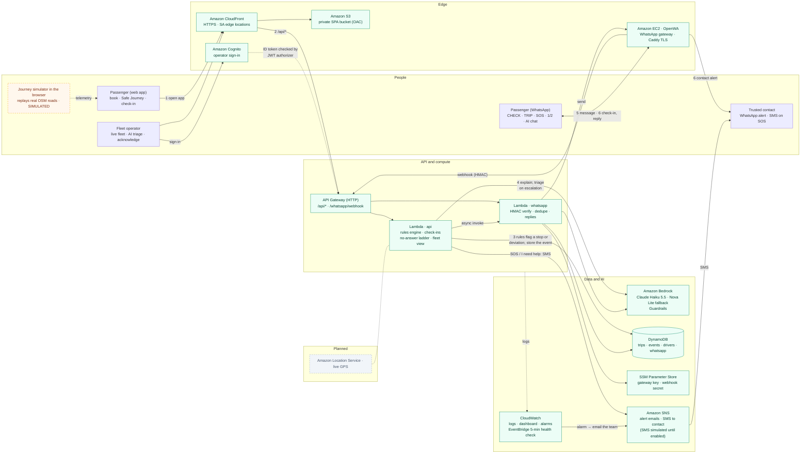

# MzansiRide SafeAI

**A safety telemetry and intelligence layer for South African e-hailing operators.** Built for the AWS AI Hackathon 2026
(theme: *AI for Real-World Impact*). Proposal: [`docs/MzansiRide SafeAI proposal.pdf`](docs/MzansiRide%20SafeAI%20proposal.pdf).

**Proactive, not reactive.** A panic button asks the passenger to act during a crisis. Here, the trip's telemetry (position,
speed, stops) goes through backend rules on every reading. A **prolonged stop** or **route deviation** triggers a
**WhatsApp check-in** ("Sarah, your trip has left the route. Are you safe? Reply 1 = Safe, 2 = Help"), which needs no app and no mobile data, only WhatsApp. **Amazon Bedrock** explains the alert in plain language.
If the passenger asks for help or doesn't answer, the system acts for them: their **trusted contact** is alerted, and
Bedrock writes a one-sentence **triage action** for the operator's safety team. The team watches the whole fleet on a live
dashboard, with each trip green, amber or red.

We sell to operators, not passengers: real-time risk telemetry, automated check-ins, faster incident handling, and an
audit trail for regulators. A shared-ride fare comparison and a WhatsApp driver/plate check complete the passenger side.

> Prototype: trips, drivers, vehicles, alerts and notifications are **simulated** and clearly labelled. It does not claim
> to prevent crime or guarantee safety, and the AI does not replace emergency services (10111 / 112).

## Architecture


Deeper dive: [architecture, trade-offs and scaling](docs/architecture-and-scaling.md).

<details open>
<summary>The same architecture as a Mermaid diagram (rendered by GitHub, editable as text)</summary>



Solid = implemented · dashed orange = simulated in the prototype · dashed grey = planned. The numbers follow the same flow as the image above.
</details>

| Service | Role in the prototype |
|---|---|
| **Amazon CloudFront + S3** | Serves the React SPA over HTTPS from the Johannesburg and Cape Town edges. The bucket is private (OAC). `/api/*` is forwarded to API Gateway, so the page and API share one origin (no CORS). |
| **Amazon API Gateway (HTTP API)** | `ANY /api/{proxy+}` → `api` Lambda. `POST /whatsapp/webhook` → `whatsapp` Lambda. Throttled to 25 rps (burst 50). |
| **AWS Lambda `api`** (Python 3.13, arm64) | Trips, **safety rules engine**, check-ins, escalation, trusted-contact notifications, assistant, dashboard. |
| **AWS Lambda `whatsapp`** | Verifies the OpenWA HMAC signature, deduplicates, and acknowledges at once. It then processes asynchronously (it invokes itself) and replies through OpenWA. |
| **Amazon Bedrock** (Claude Haiku 5.5, EU inference profile; Amazon Nova Lite as fallback model) | Explains alerts and answers safety questions (Converse API), grounded in [`src/core/guidance.md`](src/core/guidance.md). If Claude is refused (e.g. model access not granted), Nova Lite answers instead. |
| **Amazon Bedrock Guardrails** | Content filters + prompt-attack filter + a denied topic: *criminal profiling of drivers*. The violence filter is off **for input** so that a passenger describing a threat is never blocked. |
| **Amazon DynamoDB** | `trips`, `events` (check-ins, notifications), `drivers` (demo registry, seeded by Terraform), `whatsapp` (chat↔trip links, webhook dedupe, simulator outbox). On-demand, 14-day TTL. |
| **Amazon EC2 + OpenWA** | Self-hosted WhatsApp gateway ([rmyndharis/OpenWA](https://github.com/rmyndharis/OpenWA), MIT). Caddy provides TLS and exposes **only** `send-text` and `health`. Admin goes through SSM Run Command (no SSH, no public dashboard). |
| **SSM Parameter Store** | OpenWA API key (published by the instance on first boot), webhook HMAC secret, base URL, session id. |
| **Amazon CloudWatch** | JSON logs, a dashboard (events, check-ins, WhatsApp traffic, Bedrock latency and tokens) and error alarms. |
| IAM | One least-privilege role per function. No AWS credentials in the browser. CI deploys via GitHub OIDC. |

### How a safety alert flows
1. The browser **journey simulator** replays a real OSM road route and posts a position every second (`POST /api/trips/{id}/telemetry`, trip-time clock).
2. `core/rules.py` (pure, unit-tested) flags `PROLONGED_STOP` (no movement for 3 min, away from pickup or destination) or `ROUTE_DEVIATION` (> 250 m from the route for 2 readings in a row). The event is stored as `awaiting_checkin`.
3. The UI shows **"Are you OK?"**. `POST .../explain` asks Bedrock for a calm, neutral explanation (cached per event). If Bedrock fails, a rules-based text is shown, labelled as a fallback.
4. **I'm OK** → `resolved_ok`. **I need help** → `escalated` + trusted contact notified. **No answer for 2 min of trip time** → escalated automatically. Every escalation (and SOS) gets an **AI triage** sentence for the operator (`assistant.triage`, rules-based text if Bedrock is down).
5. If the passenger gave their WhatsApp number when booking (or sent `TRIP <code>`), the same prompt goes to WhatsApp, and replying `1`/`2` resolves it there. Real messages go to any valid number, with a send limit per number and per day; without the gateway (local mode) they go to the in-browser WhatsApp simulator.
6. The **Fleet** dashboard shows every live trip: green (normal), amber (waiting for a check-in), red (escalated, nobody has picked it up), blue (operator handling). The operator acknowledges with one click ("Called driver"). **Run demo fleet** drives five simulated trips, one of which goes wrong.

## Status: completed, simulated and outstanding

| Feature (proposal §8.1) | Status | Notes |
|---|---|---|
| Responsive booking interface | ✅ Completed | React 19 + TS + Tailwind 4, mobile and desktop |
| Driver & vehicle details | 🧪 Simulated | Demo registry in DynamoDB with an illustrative safety score, labelled "not verified" |
| Journey screen + Safe Journey Mode | ✅ Completed | Leaflet map on real OSM routes, trip clock, HUD |
| Two safety-event rules | ✅ Completed | Backend rules; positions are simulated (no live GPS) |
| Passenger check-in prompt | ✅ Completed | Plus auto-escalation and a measured time to prompt |
| Bedrock safety assistant | ✅ Completed | Grounded prompt, Guardrail, fallback, per-event cache |
| Alert dashboard → **Fleet safety dashboard** | ✅ Completed | Live fleet map + list (green/amber/red), speed, AI triage, operator acknowledge, demo fleet, system health panel |
| AI triage for the operator (repositioning) | ✅ Completed | Bedrock one-sentence next action on every escalation; rules-based fallback |
| Proactive WhatsApp check-ins (repositioning) | ✅ Completed | Passenger number at booking, personalised prompt, no TRIP code needed |
| Check-in replies in your own words | ✅ Completed | Bedrock classifies OK / help / unclear; danger words escalate without AI; unclear asks again, never closes |
| No-answer ladder | ✅ Completed | Operator-set wait window (Fleet page), reminder at half the window, then trusted contact + operator alert |
| Plate photo check | ✅ Completed (app) / ⏳ WhatsApp | Bedrock reads the plate, registry lookup, photo not stored. WhatsApp photos only if OpenWA sends them inline |
| Driver Face ID at start of ride | 🧪 Simulated | Driver card, WhatsApp and triage show Verified / Not verified. Real biometrics are Phase 2 |
| Waze / Google Maps roads not flagged | ✅ Completed | 35 OSRM alternative roads (`scripts/fetch_routes.py`); off every road but closing on the destination needs 500 m / 4 readings |
| Regular-trip budget | ✅ Completed | Fare comparison per week / month / year, alone vs shared |
| Ask AI button + installable web app | ✅ Completed | Floating assistant button on every page; PWA manifest + icons (Add to Home Screen) |
| Trusted-contact notification | ✅ Completed | Real WhatsApp alert via OpenWA to any valid number (20/number/hour, 500/day) |
| SMS to the trusted contact | 🧪 Simulated | Built on Amazon SNS (one SMS on SOS or "I need help" only), but this account isn't enabled for SMS yet, so `enable_sms = false` in `infra/target.auto.tfvars` and the app shows "simulated". Once AWS enables SMS: set it to true and verify numbers (`make sms-verify NUMBER=`) |
| WhatsApp on/off switch | ✅ Completed | Fleet page. Off: no WhatsApp sends, the simulator is disabled, people who message the bot get one "paused" reply an hour |
| Alert emails when something is down | ✅ Completed | EventBridge health check every 5 min → CloudWatch metrics → alarms → SNS email (alarm and recovery) |
| Operator sign-in | ✅ Completed | Amazon Cognito (invite-only `operators` group), API Gateway JWT authorizer on the Fleet routes. Replaces the shared team code |
| Individual vs shared fare comparison | ✅ Completed | Illustrative pricing rules |
| AWS-backed workflow | ✅ Completed | Terraform, CI/CD, monitoring |
| **WhatsApp channel** (team addition) | ✅ Completed | Driver check, trip link, check-ins, SOS, AI chat + web simulator |
| Live GPS, map-matched deviation | ⏳ Outstanding | Amazon Location Service + device location |
| Passenger accounts | ⏳ Outstanding | Passengers book without an account today; a Cognito `passengers` group would add trip history |
| Emergency services, real driver verification, payments, matching | ⏳ Outstanding | Need partners, compliance and operational processes |

## Run it

Prereqs: Terraform ≥ 1.10, Python 3.12+ with `uv`, Node 22+, AWS CLI v2 logged in to the team account (`aws login`), region **eu-west-1**.

```bash
make setup        # .venv + web deps
make test         # 80 backend tests + typecheck + lint
make local        # full app on http://localhost:8077, in-memory DB, offline AI fallback (= backup demo)
make local-ai     # same with real Bedrock
make init         # terraform init (state bucket: ./scripts/bootstrap_state.sh, once per account)
make deploy       # tests → terraform plan → apply that plan → upload SPA → invalidate
make url
make e2e          # Playwright journey (live: E2E_URL=$(make url) E2E_USER=<operator email> E2E_PASS=... make e2e)
```

Optional `infra/terraform.tfvars` (git-ignored):

```hcl
wa_number    = "+27 82 000 0000"             # the number linked to OpenWA (shown in the app)
budget_email = "you@example.com"
model_id     = "eu.anthropic.claude-haiku-5-5"
```

### WhatsApp (OpenWA) one-time setup
1. `make deploy` creates the EC2 instance. On first boot it starts OpenWA + Caddy and publishes the API key to SSM (~3 min).
2. `make wa-setup` creates the session, registers the webhook with its HMAC secret, and starts it.
3. `make wa-qr` saves the QR code to `build/whatsapp-qr.png` and opens it. Scan it with the **spare** phone: WhatsApp → Linked devices.
4. Message the number: `hi`. Check `make logs-wa` and `make wa-status`.

Use a spare number: OpenWA is an unofficial client, and WhatsApp may restrict accounts that use it.

### WhatsApp: when messages stop arriving
WhatsApp updates its web app without notice. Sometimes the new version shows a pop-up that OpenWA can't handle,
and every send times out while the session still says `ready`. Fix it in about a minute, without a new QR scan:

```bash
aws login --remote            # in a separate terminal, if your session expired
unset AWS_PROFILE             # use the profile you logged in with (here: default)
make wa-status                # session state + public health endpoint
make wa-restart               # recreate the gateway container: fresh browser, same login (~1 min)
make wa-send TO=0821234567    # send a test message through the real path (Lambda -> gateway)
make wa-send TO=0821234567 MSG="Demo check"
make logs-wa                  # tail the WhatsApp Lambda logs if it still fails
```

- **How you notice:** the **System health** panel on the Fleet page turns the WhatsApp tile amber or red, or
  `make logs-wa` shows `whatsapp_send_failed … The read operation timed out`.
- **Why recreate, not restart:** `docker restart` keeps Chromium's cached copy of the broken WhatsApp Web page.
  `make wa-restart` removes and recreates the container (same settings as `openwa/user_data.sh.tftpl`); the WhatsApp
  login lives on the `/opt/openwa/data` volume, so it survives. The image is checked before the old container is removed.
- **If it's still broken:** `make wa-dashboard` opens the OpenWA dashboard through a private tunnel
  (http://localhost:2785) so you can see the session; as a last resort, re-link with `make wa-qr`.
- During a demo, the **WhatsApp simulator** page runs the same backend logic and is the fallback.

### Moving to another AWS account (e.g. the hackathon sandbox)
One script redeploys everything into whichever account you're logged into and makes it the active target
(`infra/backend.hcl` + `infra/target.auto.tfvars`; `make`, the WhatsApp scripts and CI all follow them).

```bash
export AWS_PROFILE=sandbox            # or paste the sandbox's AWS_ACCESS_KEY_ID / SECRET / SESSION_TOKEN
make switch REGION_TO=us-east-1 ARGS=--check                      # preflight: account, region, Bedrock models. Changes nothing
make switch REGION_TO=us-east-1 ARGS="--old-profile default"      # full switch (~15 min), stops the old WhatsApp gateway
make switch REGION_TO=us-east-1 ARGS="--old-profile default --ci" # ...and point GitHub deploys at the new account
```

What it does:
1. Confirms the target account and region.
2. Tests which Bedrock models answer: Claude Haiku 5.5 preferred, Nova Lite as fallback.
3. Creates the Terraform state bucket.
4. Runs `make deploy`.
5. Smoke-tests the site and sets the check-in wait window to 5 minutes.
6. Waits for the new WhatsApp gateway, registers it and fetches the QR code.
7. With `--old-profile`, stops the old gateway so two gateways don't both answer.
8. With `--ci`, re-points GitHub deploys.

Afterwards:
- **Scan the QR code** with the bot phone (`make wa-dashboard` shows a fresh one), then `make wa-send TO=<your number>`.
- **New URL and Fleet code.** Both are printed at the end. The new DynamoDB starts empty; the driver registry is re-seeded.
- **Switching back** is the same command, run with the old profile and region (the old state bucket is reused).
- **Without `--ci`, don't push** `infra/backend.hcl` or `infra/target.auto.tfvars`, or CI deploys to the wrong account.

### Continuous deployment
Every push to `main` runs `.github/workflows/deploy.yml`: pytest + typecheck + lint + build → `terraform plan -out` → apply
that plan → publish the SPA → smoke-test the live URL. PRs run the tests only. One-time: `./scripts/bootstrap_ci.sh`
(GitHub OIDC role `github-deploy-mzansiride`, no stored AWS keys).

## Repo map

```
src/core/       channel-agnostic logic: rules, fares, assistant (+guidance.md), trips, drivers, notify, commands (WhatsApp)
src/api/        web API Lambda          src/whatsapp/  OpenWA webhook + sender Lambda
web/            React app (pages/, components/, lib/sim.ts = journey simulator), e2e/ Playwright
infra/          Terraform               openwa/        EC2 boot script (OpenWA + Caddy)
scripts/        local_server.py (offline mode), openwa.sh (admin via SSM), bootstrap_ci.sh
docs/           architecture, presentation-notes.md, aws-services-qa.md, screenshots/,
                presentation/ (the deck + two-presenter script)
```

## Privacy, security, responsible AI
- **Rules detect, AI explains**: detection is deterministic and tested. The AI can't trigger or suppress an alert.
- Alerts are framed as **check-ins, not accusations**. The prompt forbids blaming drivers or predicting crime, and the Guardrail denies profiling.
- Every AI surface shows **10111 / 112**, and the assistant says it can't call anyone or know whether you're safe.
- **Simulated data only**. Phone numbers are masked in the UI and logs, and records expire after 14 days (TTL). A real version would need a POPIA assessment, consent and retention rules.
- No AWS credentials in the frontend. Secrets are in SSM, IAM is least-privilege, and the OpenWA admin API is never exposed.
