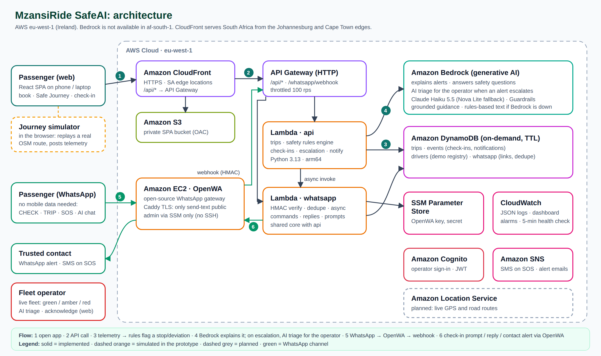

# MzansiRide SafeAI: Monday progress report (80% completion)

**Team:** Praesignis, two members · **Event:** AWS AI Hackathon 2026 (theme: *AI for Real-World Impact*) · **Date:** 26 October 2026
**Live app:** https://dhwgvfx1293ch.cloudfront.net · **Region:** AWS eu-west-1 (Ireland)

This report follows the eight items the Monday presentation must cover (Hackathon 2026 Project Requirements, §3),
then covers security and privacy (§5 of the requirements), testing and the backup plan (§7), feasibility and scale (§9),
and the final submission checklist (§8). Anything not real is labelled **simulated**, here and in the app.

**Progress: 24 of the 27 planned items are built (about 89%).** 20 are complete, 3 are built on simulated data, and 1 is
complete in the app but only partly on WhatsApp. The 3 outstanding items are outside the prototype's scope (see section 8).

---

## 1. Problem statement

- **Personal safety.** For many South African passengers, especially women, students and anyone travelling alone at night,
  getting into a car with a stranger is stressful. GBV, kidnapping and unexpected route changes are real concerns. When
  something feels wrong, the passenger is alone with the decision: *is this stop normal? should I worry? does anyone know
  where I am?*
- **Safety features are reactive.** Most apps offer a panic button. It asks the passenger to act in the middle of a crisis,
  which is exactly when it's hardest to do anything.
- **No mobile data.** Many people have WhatsApp bundles but no general mobile data, so a safety app that needs data fails
  the people who need it most.
- **Cost.** Daily commuters and students spend a large share of their income on transport.

## 2. Proposed solution

**MzansiRide SafeAI is a safety telemetry and intelligence layer for e-hailing operators: proactive, not reactive.**
It watches the data of every trip, notices when something looks wrong, and acts on the passenger's behalf.

**Target users**
- **The customer:** the e-hailing operator's safety team (B2B). They get real-time risk telemetry, automated check-ins,
  faster incident handling and an audit trail for regulators.
- **The people it protects:** passengers, especially women and vulnerable passengers, students, daily commuters and
  budget-conscious riders.

**Key features**
1. **Safe Journey Mode.** Backend rules watch every trip for a **prolonged stop** or a **route deviation**. A driver taking
   a known alternative road, such as the one Waze suggests, is not flagged.
2. **Proactive WhatsApp check-in.** For example: "Sarah, your trip has left the route. Are you safe? Reply 1 = Safe,
   2 = Help". It needs no app and no mobile data. Passengers can also reply in their own words, which the AI reads.
3. **No-answer ladder.** The operator sets the wait window. The passenger gets a reminder at half the window. At the full
   window the trusted contact and the operator are alerted.
4. **AI safety assistant** (Amazon Bedrock). It explains *why* we're asking and what the passenger's options are, and
   answers safety questions.
5. **Trusted-contact alert** with the driver, the car and the last location.
6. **Driver check.** Look up a plate or a name, or photograph the number plate, before getting in. A driver Face ID result
   is shown at the start of the ride (simulated).
7. **Fleet safety dashboard** for the operator. Every live trip is green, amber or red, with a one-sentence **AI triage**
   action and an acknowledge button.
8. **Shared-ride fare comparison**, including weekly and monthly commute budgets.
9. **The whole flow also works on WhatsApp:** driver check, trip link, check-ins, SOS and AI chat.

We never assume the driver did something wrong: stops have normal reasons. An alert is a check-in, not an accusation.

## 3. Architecture

The same diagram as editable Mermaid is in the [README](../README.md#architecture). Trade-offs and scaling are in
[architecture-and-scaling.md](architecture-and-scaling.md).

**Main components and how data flows**
1. The passenger opens the React app from **Amazon CloudFront**, which serves South Africa from its Johannesburg and Cape
   Town edge locations. The files sit in a private **Amazon S3** bucket.
2. API calls go through the same CloudFront address to **Amazon API Gateway**, which runs **AWS Lambda** (the `api` function).
3. Every few seconds the trip sends a position. The **rules engine** in Lambda decides whether there is a stop or a
   deviation and stores the event in **Amazon DynamoDB**.
4. Only then is **Amazon Bedrock** called, to explain the event to the passenger or, on escalation, write the operator's
   triage line. **The rules detect; the AI explains.**
5. On WhatsApp, a message reaches **OpenWA**, an open-source WhatsApp gateway on a small **Amazon EC2** server. It calls our
   webhook, which is signature-checked, and a second Lambda (`whatsapp`) answers using the same core code.
6. Check-in prompts, replies and trusted-contact alerts go back out through OpenWA.

**Around the core**
- **Amazon Cognito:** operators sign in to the Fleet page, and API Gateway checks the token before any code runs.
- **Amazon SNS:** emails the team when something is down and again when it recovers. It also carries the SMS to the
  trusted contact, which is simulated for now (see section 8).
- **Amazon EventBridge** runs a health check every 5 minutes.
- **Amazon CloudWatch** holds logs, metrics, a dashboard and the alarms.
- **AWS Systems Manager Parameter Store** holds the gateway secrets.
- Everything is **Terraform**, deployed by GitHub Actions on every push, using OIDC rather than stored AWS keys.

**Simulated and planned parts in the diagram:** the dashed orange box (the journey simulator) is simulated, and the dashed
grey box (Amazon Location Service) is planned. Everything drawn solid is built and running.

## 4. Frontend

A complete, demo-ready **React 19 + TypeScript + Tailwind** web app that works on a phone or a desktop and can be installed
to the home screen.

| Page | What it shows |
|---|---|
| **Book** | Pickup and destination, trusted contact, optional WhatsApp number, fare comparison (alone vs shared) |
| **Trip** | Live map on real road routes, driver card (plate check, Face ID result), Safe Journey status, check-in prompt, safety log, simulator controls |
| **Ask AI** | The safety assistant, also one tap away from every page |
| **WhatsApp** | An in-browser WhatsApp simulator, so the channel can be shown without a phone |
| **Fleet** (operators, signed in) | Live fleet map and list (green / amber / red), AI triage, acknowledge, the demo fleet, system health, the WhatsApp on/off switch, the check-in wait window |
| **About** | Completed / simulated / outstanding, kept honest |

It's tested end to end with 7 Playwright tests (desktop and mobile).

## 5. AI integration

**Why AI suits this problem.** The rules can tell *that* a car stopped for 4 minutes off-route. They can't turn that
into a calm, plain-language message for a worried passenger. They can't understand a reply like "we took a detour,
still going to Sandton". And they can't summarise an escalation into one clear action for a busy safety team. Those are
language tasks, so we use a language model for them and keep everything safety-critical in deterministic code.

**How users interact with it**
- **Passengers:** on the trip screen ("Why am I being asked?"), in the "Ask AI" assistant on every page, by answering a
  check-in in their own words, by photographing the plate, and on WhatsApp (any question, or a free-text reply).
- **Operators:** the AI triage line on each red trip in the Fleet dashboard.

**Model:** **Amazon Bedrock** through the Converse API. The main model is **Claude Haiku 5.5**. **Amazon Nova Lite** answers
automatically when Claude isn't available, which is the case on our account today. **Bedrock Guardrails** sit on top.

What the AI does (and what it doesn't)
- **Explains alerts** to the passenger in plain language, grounded in approved safety guidance.
- **Reads check-in replies in the passenger's own words**, as OK, help or unclear. Danger words such as "knife" or
  "won't stop the car" escalate immediately without waiting for the AI. An unclear reply never closes the alert.
- **Writes a one-sentence triage action** for the operator's safety team whenever an alert escalates.
- **Reads a number plate from a photo** for the driver check. The photo is not stored.
- **Answers safety questions** in the assistant and on WhatsApp.
- **It does not decide.** Detection is deterministic, unit-tested rules. The AI never accuses a driver, and it never
  replaces emergency services (10111 / 112). If Bedrock is down, a rules-based text is shown and labelled.

**Limitations, and how the output is handled responsibly**
- **The model can be wrong,** so it never makes the safety decision: the rules raise the alert, and escalation happens on
  a timer whatever the AI says.
- **Replies are read cautiously:** danger words always escalate, and an unclear reply asks again rather than closing the
  alert.
- **Answers are grounded** in a short approved guidance file, at a low temperature. **Bedrock Guardrails** filter harmful
  content, prompt attacks and a denied topic, "criminal profiling". The violence filter is off for passenger input,
  because "he has a knife" must get help, not a refusal.
- **Fallbacks are labelled:** when the AI can't answer, the app shows a rules-based text and says so.
- **Privacy:** plate photos are read and discarded, never stored. The model doesn't train on our data.

## 6. AWS implementation

| Service | What it does here | Why it's appropriate |
|---|---|---|
| **Amazon Bedrock** + Guardrails | Explanations, reply reading, triage, plate reading, assistant | Managed models with no GPUs, pay per call (about $0.003), data not used for training, guardrails built in |
| **AWS Lambda** (×2, Python, arm64) | `api`: trips, rules, check-ins, escalation, fleet view. `whatsapp`: webhook, conversation, replies | No servers, scales to zero, pay per request. One shared core keeps web and WhatsApp identical |
| **Amazon API Gateway** (HTTP API) | One HTTPS entry point, throttled, with a Cognito JWT authorizer on operator routes | Cheap, managed throttling, and bad tokens are rejected before Lambda runs |
| **Amazon DynamoDB** | Trips, events, drivers, WhatsApp chat links, rate limits, health counters (TTL 14 days) | Fast key lookups, on-demand capacity, automatic data expiry |
| **Amazon CloudFront + S3** | Serves the app from SA edge locations; forwards `/api/*` | HTTPS with no web servers; same origin, so no CORS |
| **Amazon EC2** (OpenWA) | Two-way WhatsApp on a real number | WhatsApp today without waiting for Meta business verification (production: AWS End User Messaging Social) |
| **Amazon Cognito** | Operator sign-in (invite-only) | Per-person access instead of a shared code; tokens expire |
| **Amazon SNS** | Alert emails to the team; SMS to the trusted contact (simulated for now) | No extra tooling for alerting; SMS works without WhatsApp or data |
| **Amazon EventBridge + CloudWatch** | 5-minute health check, metrics, alarms, logs, dashboard | Built-in monitoring; an alarm also fires if the check itself stops |
| **SSM Parameter Store** | Gateway API key, webhook secret | Free, encrypted, IAM-scoped |
| **IAM + GitHub OIDC, Terraform** | Least-privilege roles; infrastructure as code; CI/CD | No stored AWS keys; the whole stack can be rebuilt in another account with one command |

**Why eu-west-1:** Bedrock isn't available in af-south-1 (Cape Town). CloudFront still serves users from South African edge
locations. **Cost:** close to nothing when idle, apart from the WhatsApp server (about $15–20 a month).

## 7. Working prototype

**Main user journey (the live demo)**
1. A passenger books a ride with a trusted contact and their WhatsApp number, and compares the fare alone vs shared.
2. They check the driver: the plate lookup, a plate photo, and the Face ID result.
3. The trip starts in Safe Journey Mode and the car moves along a real Johannesburg road route.
4. The car stops for too long, or leaves the route. A **WhatsApp check-in** arrives, and Bedrock explains why.
5. The passenger answers "I need help", or doesn't answer. The **trusted contact is alerted** with the car and location.
6. On the **Fleet page** the trip turns **red** with an AI triage line, and the operator acknowledges it.

**Implemented and working on AWS today**
- Booking, the trip screen with Safe Journey Mode, and both safety rules (prolonged stop and route deviation, with
  alternative roads not flagged)
- Check-ins on web and real WhatsApp: reminder, escalation, and replies in the passenger's own words
- Bedrock explanations, reply reading, operator triage, plate reading and the assistant, with a fallback model and
  Guardrails
- Real WhatsApp alerts to the trusted contact, rate-limited per number
- The Fleet dashboard behind Cognito sign-in, with acknowledge, the demo fleet, the health panel and the WhatsApp switch
- Email alerts to the team when a service is down and when it recovers
- The fare comparison and commute budget, the installable web app, and the "Ask AI" button on every page
- **Quality:** 80 backend unit tests, 7 end-to-end browser tests, typecheck and lint; every push to `main` is tested and
  then deployed

**Simulated (labelled in the app)**
- Car positions: a real road route is replayed instead of live GPS
- The driver registry and safety score: demo data, not an official check
- The driver Face ID result
- The SMS to the trusted contact (see section 8)

## 8. Outstanding work

| Remaining work | What's needed | Rough effort |
|---|---|---|
| **Live GPS and map-matched deviation** | A driver app sending real positions, and Amazon Location Service for routes and road-snapping. The rules stay the same | 1–2 weeks |
| **Real SMS to the trusted contact** | Built and tested against SNS, but our AWS account is on the free plan, which blocks SMS. Upgrade the plan, verify numbers, switch it on | Hours, once the account is upgraded |
| **Claude as the main model** | Same free-plan limit. Nova Lite answers meanwhile; the switch back is a setting | Hours, once the account is upgraded |
| **Passenger accounts** | A Cognito `passengers` group and phone sign-in, so trips and trusted contacts follow the passenger | 1–2 days |
| **Plate photos on WhatsApp** | Works in the app; on WhatsApp only when the gateway sends the image inline | Depends on the gateway |
| **Official WhatsApp Business API** | Replace OpenWA with AWS End User Messaging Social, plus message templates | 2–3 days plus Meta verification |
| **Real driver verification** | Face ID or a fingerprint on the driver's phone, plus an ID and licence check. Needs a POPIA assessment | 2–4 weeks plus a partner |
| **Emergency-service integration** | A response-centre partner called at escalation, with a person in the loop | Depends on the partner |
| **Payments and ride matching** | Out of scope: the safety layer plugs into an operator's existing app | Not our focus |

## Security and privacy

- **Operator access:** Amazon Cognito sign-in (invite-only). API Gateway's JWT authorizer rejects requests without a valid
  token before any code runs, and the code also checks the `operators` group.
- **No secrets in the browser:** the app has no AWS keys. Gateway secrets live in SSM Parameter Store. CI deploys through
  GitHub OIDC with a least-privilege role, so no long-lived AWS keys are stored anywhere.
- **WhatsApp gateway locked down:** the webhook is HMAC-signed and de-duplicated. Only the gateway's `send-text` and
  `health` endpoints are public (behind TLS). Admin is through AWS Systems Manager only: no SSH, no public dashboard.
- **Abuse limits:** API Gateway throttling. Real WhatsApp and SMS sends are rate-limited per number per hour and per day.
  Test numbers are never messaged.
- **Data minimisation:** trips and alerts expire after 14 days (DynamoDB TTL). Plate photos aren't stored. The health panel
  and the alert emails show counts only, never phone numbers or raw logs. The prototype uses simulated trips and drivers.
- **Fairness:** an alert is a check-in to the passenger, never an accusation shown to the driver. The registry lookup says
  clearly that it isn't a police or licensing check.
- **POPIA (production):** Bedrock isn't available in Cape Town, so data is processed in Ireland. A production launch
  needs a cross-border transfer assessment, consent at booking, and a biometrics assessment for driver verification.

## Testing and backup demonstration plan

**Tested**
- **80 backend unit tests**, with the AWS services mocked. They cover the rules (no false alarm on a normal trip or on a
  known alternative road; short stops ignored), check-ins, the no-answer ladder, escalation, WhatsApp commands and the
  pause switch, rate limits, SMS, health, and operator access.
- **7 end-to-end browser tests** (Playwright, desktop and mobile). They run the main journey from booking to escalation to
  the Fleet dashboard, plus the demo fleet, the driver checks, the alternative road, the WhatsApp switch, the WhatsApp
  simulator and the assistant.
- **Live checks on AWS:** sign-in protection (requests without a valid token are refused), the alert emails (a test
  alarm sent both ALARM and OK emails), and real WhatsApp messages.
- Typecheck and lint run on every push, and CI deploys only after all of these pass.

**Backup plan if something fails during the demo**
1. **WhatsApp gateway problem:** `make wa-restart` fixes the usual fault in about a minute and keeps the login. Or show the
   same conversation in the app's WhatsApp simulator.
2. **Bedrock slow or refused:** the fallback model or the labelled rules-based text answers. The demo continues.
3. **Live site or venue internet problem:** `make local` runs the whole app on a laptop (in-memory database, offline AI
   fallback), with the same screens and the same journey.
4. **Everything else:** screenshots of every step are in `docs/screenshots/`, and the deck shows the journey.

**Both members can explain everything:** the presenter notes split the sections between the two of us, and each of us
rehearses the other's part too. The AWS services, the trade-offs and practice answers to hard questions are in
[aws-services-qa.md](aws-services-qa.md).

## Feasibility and scalability

- **Feasible now:** the prototype already runs on managed AWS services. Turning it into a pilot mainly means adding live
  GPS, the official WhatsApp API and an operator's real trip feed. The rules, the AI and the dashboard stay as they are.
- **Scales with use:** Lambda, API Gateway and DynamoDB on-demand scale automatically, and cost grows with trips.
  **Limits today:** Lambda concurrency is 10 on this account, and the API is throttled at 100 requests a second.
- **Path to scale:** from thousands of trips, raise the quotas and batch the readings. From 100,000 trips, stream
  telemetry through IoT Core or Kinesis, give each operator its own data partition, and add a second region.
  Details: [architecture-and-scaling.md](architecture-and-scaling.md).
- **Impact:** a passenger is checked on within minutes of a stop or a deviation, even with no data and without pressing
  anything. The operator sees every at-risk trip, with a suggested action and an audit trail.

## Final submission checklist (requirements §8)

- [x] The team consists of two members.
- [x] At least 80% of the planned work is completed (24 of 27 items, about 89%).
- [x] The architecture diagram is ready and can be explained (section 3; `docs/architecture.png` and the Mermaid version in the README).
- [x] The frontend is complete and demo ready (section 4).
- [x] The main user journey can be demonstrated (section 7, live, plus the backup plan).
- [x] The AI functionality is demonstrated (section 5), with the current model limit explained (Nova Lite answers until the account is upgraded).
- [x] The AWS services and their purpose are identified (section 6).
- [x] The implemented features have been tested (unit, end-to-end and live checks).
- [x] Completed, simulated and outstanding features are clearly identified (sections 7 and 8, and the app's About page).
- [x] Both team members understand the solution and can contribute to the presentation (split and rehearsed; Q&A notes).
- [x] The remaining work and next steps are documented (section 8).
